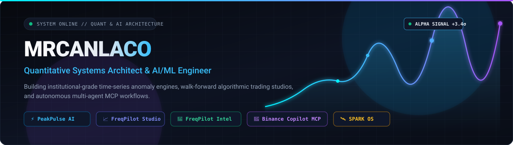
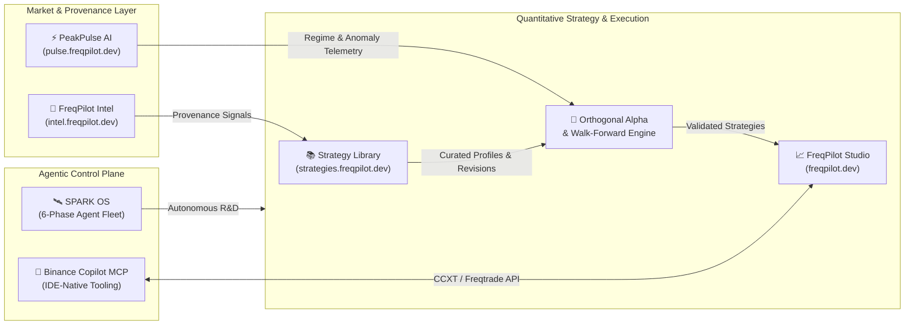

 

---

### ⚡ Executive Overview

I design and engineer **evidence-first quantitative trading infrastructure**, **real-time financial market anomaly detection engines**, and **autonomous AI agent ecosystems**. My work bridges low-latency data pipelines, rigorous walk-forward statistical validation, and IDE-native Model Context Protocol (MCP) tooling.

- 🔬 **Quantitative Research & Validation:** Multi-timeframe orthogonal alpha modeling, out-of-sample walk-forward optimization, and 1x paper-trading validation pipelines on top of Freqtrade & Rust/Python execution cores.
- 🧠 **Time-Series ML & Anomaly Detection:** High-throughput market microstructure scanning, DuckDB analytical pipelines, and real-time regime/anomaly telemetry (`PeakPulse AI`).
- 🤖 **Agentic AI & MCP Infrastructure:** Zero-friction bridges connecting algorithmic trading engines (`CCXT` / `Freqtrade`) and 6-phase autonomous agent fleets (`SPARK OS`) directly to modern AI coding environments.

---

### 🚀 Flagship Ecosystem & Open-Source Projects

| Project | Live Portal | Architecture & Focus | Core Stack |
| :--- | :---: | :--- | :--- |
| **[PeakPulse-AI](https://github.com/mrcanlaco/PeakPulse-AI)** | [`pulse.freqpilot.dev`](https://pulse.freqpilot.dev) | **Real-Time Market Anomaly Detection & Time-Series ML Engine** High-frequency market scanning, statistical regime shifts, and interactive financial telemetry pipelines. |     |
| **[freqpilot](https://github.com/mrcanlaco/freqpilot)** | [`freqpilot.dev`](https://freqpilot.dev) | **Quantitative Research, Walk-Forward Validation & Trading Studio** End-to-end strategy lab built on Official Freqtrade 2026.9 with Rust/Python acceleration and Vue UI. |     |
| **Strategy Library** | [`strategies.freqpilot.dev`](https://strategies.freqpilot.dev) | **Consolidated Strategy Research & Evidence Hub** Deduplicated strategy profiles, test revisions, result artifacts, and automated sync on Cloudflare D1 & R2. |    |
| **[freqpilot-intel](https://github.com/mrcanlaco/freqpilot-intel)** | [`intel.freqpilot.dev`](https://intel.freqpilot.dev) | **Evidence-First Research & Market Provenance Workspace** Public-source intelligence platform with verifiable data provenance and browser-local research synthesis. |    |
| **[binance-copilot-mcp](https://github.com/mrcanlaco/binance-copilot-mcp)** | [GitHub Repo](https://github.com/mrcanlaco/binance-copilot-mcp) | **The Zero-Friction AI Copilot for Binance (MCP Server)** Bridges Freqtrade/CCXT market execution & backtesting directly into Cursor, Windsurf, Claude Desktop & Antigravity. |    |
| **[spark-os](https://github.com/mrcanlaco/spark-os)** | [GitHub Repo](https://github.com/mrcanlaco/spark-os) | **SPARK OS — AI Fleet Orchestration System** Coordinates autonomous multi-agent engineering fleets across structured 6-phase software delivery lifecycles. |    |

---

### 🏗️ Ecosystem Architecture

---

### 🛠️ Technology & Quantitative Stack

| Domain | Technologies & Tooling |
| :--- | :--- |
| **Core Languages** |      |
| **Quant, Data & ML** |       |
| **Backend & Agentic Infra** |      |
| **Frontend & Telemetry UI** |     |

---

### 📐 Engineering Principles

1. **Evidence Before Execution:** Every quantitative hypothesis is backed by reproducible provenance (`FreqPilot Intel`), strict out-of-sample walk-forward testing, and zero look-ahead bias.
2. **Orthogonal Signal Design:** Combining uncorrelated multi-timeframe structural factors with real-time anomaly detection (`PeakPulse AI`) rather than curve-fitted indicators.
3. **Agent-Native Developer Experience:** Exposing complex market data, backtesting pipelines, and deployment workflows via clean Model Context Protocol (`MCP`) interfaces.

---

  Built with precision by <b><a href="https://github.com/mrcanlaco">mrcanlaco</a></b> • Explore the live ecosystem at <a href="https://freqpilot.dev">freqpilot.dev</a>

