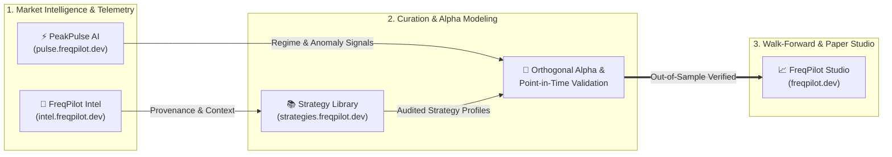

 

---

### ⚡ Executive Overview

I design and engineer **evidence-first quantitative trading infrastructure**, **real-time financial market anomaly detection engines**, and **point-in-time derivatives research platforms**. My work bridges low-latency analytical data pipelines, strict out-of-sample walk-forward validation, and systematic execution governance.

- 🔬 **Quantitative Research & Walk-Forward Validation:** Multi-timeframe orthogonal alpha modeling, strict point-in-time leakage prevention, and 1x paper-trading validation pipelines powered by Official Freqtrade & Rust/Python cores (`freqpilot.dev`).
- 🧠 **Time-Series ML & Anomaly Detection:** High-throughput derivatives microstructure scanning (Funding, Open Interest, Taker Flow), DuckDB analytical pipelines, and calibrated regime/anomaly telemetry (`pulse.freqpilot.dev`).
- 📚 **Verifiable Provenance & Strategy Registry:** Centralized strategy curation, revision auditing, and public-source market provenance tracking (`strategies.freqpilot.dev` & `intel.freqpilot.dev`).

---

### 🚀 Flagship Quantitative Ecosystem (`*.freqpilot.dev`)

| Platform | Live Portal | Architecture & Core Focus | Tech Stack |
| :--- | :---: | :--- | :--- |
| **[freqpilot](https://github.com/mrcanlaco/freqpilot)** | [`freqpilot.dev`](https://freqpilot.dev) | **Quantitative Research, Walk-Forward Validation & Trading Studio** End-to-end strategy validation lab built on Official Freqtrade 2026.9 with Rust/Python acceleration and Vue UI (1,878+ tests). |     |
| **[PeakPulse-AI](https://github.com/mrcanlaco/PeakPulse-AI)** | [`pulse.freqpilot.dev`](https://pulse.freqpilot.dev) | **Real-Time Market Anomaly Detection & Time-Series ML Engine** 24/7 derivatives microstructure radar, calibrated frozen ML bundles, and multi-timeframe structural regime telemetry (484+ tests). |     |
| **Strategy Library** | [`strategies.freqpilot.dev`](https://strategies.freqpilot.dev) | **Consolidated Strategy Registry & Evidence Hub** Deduplicated quantitative strategy profiles, test revision history, result artifacts, and automated sync on Cloudflare D1 & R2. |    |
| **[freqpilot-intel](https://github.com/mrcanlaco/freqpilot-intel)** | [`intel.freqpilot.dev`](https://intel.freqpilot.dev) | **Evidence-First Research & Market Provenance Workspace** Public-source intelligence platform with verifiable data provenance, statement comparison, and browser-local research synthesis. |    |

---

### 🏗️ Quantitative Pipeline Architecture

---

### 🛠️ Technology & Quantitative Stack

| Domain | Technologies & Tooling |
| :--- | :--- |
| **Core Languages** |      |
| **Quant, Data & ML** |       |
| **Backend & Cloud Infra** |      |
| **Frontend & Telemetry UI** |     |

---

### 📐 Engineering Principles

1. **Evidence Before Execution:** Every quantitative hypothesis is backed by reproducible provenance (`FreqPilot Intel`), strict point-in-time feature construction, and out-of-sample walk-forward audits with zero look-ahead bias.
2. **Orthogonal Signal Design:** Combining uncorrelated multi-timeframe structural factors with calibrated real-time anomaly telemetry (`PeakPulse AI`) rather than curve-fitted indicators.
3. **Fail-Closed Production Discipline:** Hash-verified frozen model bundles, calibrated probability thresholds, and explicit 1x paper-trading validation gates (`FreqPilot Studio`) prior to capital deployment.

---

  Engineered with precision by <b><a href="https://github.com/mrcanlaco">mrcanlaco</a></b> • Explore the live suite at <a href="https://freqpilot.dev">freqpilot.dev</a>

